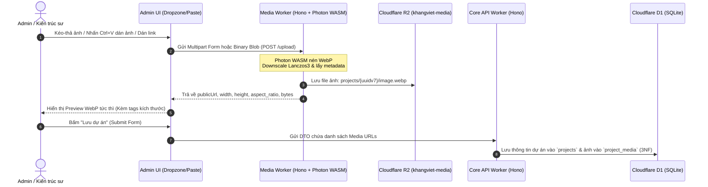

# Cẩm Nang Kiến Trúc: Database Party Model, Cloudflare R2 Media Worker & Universal UI Dropzone

> **Mục đích tài liệu:** Bản tóm tắt trực quan, giải thích bản chất kiến trúc và chức năng của **từng file mã nguồn** được tạo mới/nâng cấp. Được thiết kế theo phong cách rõ ràng, dễ hiểu để bạn đọc nhanh và nắm bắt toàn bộ bức tranh kỹ thuật sau khi hoàn thành kỳ thi.

---

## 🗺️ TỔNG QUAN LUỒNG HOẠT ĐỘNG TOÀN HỆ THỐNG (END-TO-END FLOW)

---

## PHẦN 1: TẦNG DỮ LIỆU MỚI (DATABASE SCHEMA & 3NF NORMALIZATION)
*Vị trí thư mục:* `packages/repositories/src/d1/schema/`

Hệ thống đã chuyển từ tư duy lưu trữ JSON phẳng sang **Mô hình Thực thể Doanh nghiệp (Party/Identity Model)** kết hợp **Chuẩn hóa 3NF**.

### 1. `identities.schema.ts` — Thực Thể Định Danh (Hạt Nhân Trung Tâm)
- **Ý nghĩa:** Đại diện cho bất kỳ con người hoặc pháp nhân tổ chức nào có liên hệ với Khang Việt (Khách hàng vãng lai, Chủ đầu tư, KTS, Giám đốc).
- **Điểm sáng:** Khách hàng đến văn phòng ký hợp đồng hay gửi form tư vấn **không bắt buộc phải có tài khoản đăng nhập**.
- **Các trường chính:**
  - `id`: UUIDv7 sinh tuần tự thời gian.
  - `full_name`, `phone` (được đánh Index để tra cứu nhanh chống trùng số), `email`.
  - `tax_code`: Mã số thuế doanh nghiệp (`nullable` - chỉ dùng khi là đối tác B2B).
  - `identity_type`: CHECK constraint (`INDIVIDUAL` hoặc `ORGANIZATION`).
  - `address`, `notes`: Địa chỉ và ghi chú đặc thù.

### 2. `user-accounts.schema.ts` — Tài Khoản Đăng Nhập & Phân Quyền
- **Ý nghĩa:** Tách rời hoàn toàn khỏi thông tin cá nhân. Chỉ ai cần đăng nhập vào hệ thống mới có bản ghi ở đây.
- **Các trường chính:**
  - `id`: UUIDv7.
  - `identity_id`: Khóa ngoại (`FK`) trỏ sang bảng `identities.id` (1-to-1).
  - `email`: Cột Unique làm tên đăng nhập (đã bỏ duplicate index thừa).
  - `password_hash`: Chuỗi băm mật khẩu PBKDF2 bảo mật cao.
  - `role`: CHECK constraint cứng tại SQLite (`ADMIN`, `STAFF`, `CUSTOMER`) — loại bỏ hoàn toàn nguy cơ nhập text rác.
  - `is_active`: Cờ trạng thái tài khoản (1: Active, 0: Suspended) phục vụ soft-block.

### 3. `leads.schema.ts` & `lead-activities.schema.ts` — Quản Trị Khách Hàng Tiềm Năng (Mini CRM)
- **`leads.schema.ts`:**
  - Khi khách gửi form từ trang chủ, hệ thống tự động ánh xạ với `identity_id`.
  - `service_category`: Thiết kế, thi công trọn gói, nội thất...
  - `status`: CHECK constraint (`NEW`, `CONTACTED`, `IN_PROGRESS`, `COMPLETED`, `CANCELLED`).
- **`lead-activities.schema.ts` (Mới):**
  - Giải quyết triệt để lỗi ghi đè text `notes` cũ.
  - Lưu từng mốc tương tác: nhân viên nào (`staff_identity_id`), đã làm gì (`CALL`, `MEETING`, `QUOTE_SENT`, `CONTRACT_SIGNED`), nội dung chi tiết và thời gian chính xác.

### 4. `projects.schema.ts` — Danh Mục Công Trình (Chuẩn hóa 3NF)
- **Ý nghĩa:** Xóa bỏ hoàn toàn cột `gallery` JSON khổng lồ! Giúp câu lệnh query danh sách Card trang chủ nhẹ đi 80%, không gây tràn RAM 128MB của Cloudflare Workers.
- **Các trường chính:**
  - `code`: Unique slug công trình (vd: `KV-VILLA-01`).
  - `year`: Đã đổi từ `text` sang `integer` (CHECK `1990 <= year <= 2100`).
  - `status`: CHECK (`DRAFT`, `PUBLISHED`, `ARCHIVED`).
  - `sort_order`: Số thứ tự để admin chủ động ghim công trình tiêu biểu lên đầu trang.
  - `client_identity_id`: Khóa ngoại trỏ sang `identities.id` để biết chủ đầu tư là ai.

### 5. `project-media.schema.ts` — Quản Lý Hình Ảnh & Bản Vẽ (Quan hệ 1-N)
- **Ý nghĩa:** Mỗi bức ảnh render 3D hay bản vẽ mặt bằng là một dòng dữ liệu độc lập.
- **Các trường chính:**
  - `project_id`: Khóa ngoại trỏ về `projects.id` với ràng buộc `ON DELETE CASCADE` (khi xóa dự án, toàn bộ ảnh con tự động được dọn dẹp sạch).
  - `r2_key`: Đường dẫn file trên R2 (`projects/{projectId}/{uuid}.webp`).
  - `public_url`: CDN link để web tải ảnh.
  - `media_type`: `COVER`, `GALLERY_IMAGE`, `FLOOR_PLAN`, `VIDEO`.
  - `aspect_ratio`, `width_px`, `height_px`, `file_size_bytes`: Lưu sẵn kích thước để Frontend tính layout chống giật khung hình (CLS).

---

## PHẦN 2: DEDICATED CLOUDFLARE MEDIA WORKER & R2 (S2/R2)
*Vị trí thư mục:* `apps/media-worker/src/`

Được thiết kế theo kiến trúc **Micro-Worker** độc lập, sở hữu R2 binding `MEDIA_BUCKET` (`khangviet-media`) chạy cổng `8788`. Tách riêng khỏi API chính để giải phóng tải CPU và RAM khi nén ảnh.

### 1. `src/index.ts` — Entry Point của Media Worker
- Khởi tạo ứng dụng Hono v4 siêu nhẹ.
- Đăng ký middleware CORS credentials bảo mật và mount các routes: `/health`, `/upload`, `/fetch-external`, `/file`.

### 2. `src/services/image-processor.ts` — Động Cơ Nén Ảnh WebAssembly
- **Trọng tâm kỹ thuật:** Sử dụng `@cf-wasm/photon` (WebAssembly) chạy thuần trên Edge V8 runtime (thay cho thư viện Node C++ `sharp` vốn không thể chạy trên Edge Worker).
- Tự động nhận diện định dạng ảnh đầu vào (PNG, JPEG, WEBP), decode pixel buffer.
- Áp dụng thuật toán **Lanczos3 Downscaling** nếu ảnh vượt quá kích thước chuẩn và convert sang định dạng **WebP** chất lượng tối ưu.
- **Chống rò rỉ RAM:** Bắt buộc gọi `photonImage.free()` sau khi convert để dọn dẹp heap WASM ngay lập tức.

### 3. `src/services/ssrf-validator.ts` — Bộ Lọc Bảo Mật Tấn Công SSRF Đa Tầng
- Bảo vệ endpoint tải ảnh từ xa (`POST /fetch-external`).
- Chặn đứng kẻ tấn công truyền URL dẫn tới hạ tầng nội bộ:
  - Bóc tách chuẩn hóa hostname, loại bỏ ngoặc vuông IPv6 (`[::1]`).
  - Chặn dải IP nội bộ RFC1918 (`10.0.0.0/8`, `172.16.0.0/12`, `192.168.0.0/16`).
  - Chặn IP Cloud Metadata của AWS/GCP/DigitalOcean (`169.254.169.254`).
  - Chặn dải Loopback (`127.0.0.0/8`).

### 4. `src/services/r2-storage.ts` — Giao Tiếp Cloudflare R2
- Tạo khóa file chuẩn hóa theo thời gian: `projects/{uuidv7}/{filename}.webp`.
- Ghi trực tiếp buffer nén vào Cloudflare R2 Bucket với metadata đầy đủ (`Content-Type: image/webp`).
- Hỗ trợ stream file từ R2 ra ngoài với header `Cache-Control: public, max-age=31536000, immutable`.

### 5. Thư mục `src/routes/` — Các API Endpoints
- `upload.ts`: Xử lý cả tải lên file multipart thông thường lẫn nhận dữ liệu **raw binary blob** khi người dùng dán ảnh từ Clipboard (Ctrl+V). Có cơ chế chặn sớm trần 10MB (`Content-Length`) tại tầng stream.
- `fetch-external.ts`: Nhận một URL trên mạng, kiểm tra an toàn qua `ssrf-validator`, tải dữ liệu về, nén WebP và đẩy vào R2.
- `file.ts`: Stream file ảnh từ R2 về trình duyệt client.
- `health.ts`: Endpoint `/health` trả về trạng thái hoạt động của Worker và kết nối R2 Bucket.

---

## PHẦN 3: GIAO DIỆN UNIVERSAL MEDIA DROPZONE (ADMIN UI)
*Vị trí thư mục:* `apps/web/components/ui/media-upload/`

Được thiết kế theo tư duy **Modular Component & State Machine**, thay thế hoàn toàn cờ "Bypass Path" tạm bợ cũ.

### 1. `UniversalMediaUpload.tsx` — Container Điều Phối Giao Diện
- Là component chính kết hợp toàn bộ trải nghiệm người dùng vào một khung duy nhất.
- Hỗ trợ 4 cách nạp ảnh:
  1. 📁 **Browse:** Nhấn để chọn file từ máy tính.
  2. 🖱️ **Drag & Drop:** Kéo thả tệp vào vùng dropzone.
  3. 📋 **Clipboard Paste (Ctrl+V):** Chỉ cần chụp màn hình hoặc copy ảnh trên mạng, click vào form và bấm `Ctrl+V` -> Ảnh tự động được đẩy lên R2!
  4. 🌐 **External URL:** Dán link ảnh ngoài vào thanh fetch.
- Hiển thị preview ngay lập tức kèm thẻ tag định dạng WebP, kích thước pixel và dung lượng tệp.

### 2. `useMediaUpload.ts` — Custom Hook Quản Lý State & Logic
- Quản lý State Machine trực quan: `idle` ➔ `dragging` ➔ `uploading` (với thanh % tiến trình) ➔ `success` / `error`.
- Bắt sự kiện bàn phím `onPaste` toàn cục trên vùng input để trích xuất file blob từ `clipboardData.items`.
- Xử lý mượt mà việc hủy ảnh và đổi ảnh mới.

### 3. `mediaUploadService.ts` — Tầng Dịch Vụ Mạng (Network Service)
- Tách riêng toàn bộ logic gọi `fetch()` ra khỏi React Component (tuân thủ Single Responsibility).
- Chứa các hàm: `uploadFileMultipart()`, `uploadClipboardBlob()`, và `fetchExternalUrl()`.

### 4. Các Sub-views Nhỏ Gọn (Mỗi file < 95 dòng)
- `MediaDropzoneView.tsx`: Render vùng nét đứt kéo thả với hiệu ứng viền sáng đổi màu chuẩn Tailwind CSS v4 (`border-(--accent-bronze)`).
- `MediaPreviewCard.tsx`: Render ảnh sau khi upload thành công, hỗ trợ nút xóa ảnh và hiển thị thông số kỹ thuật.
- `MediaUrlFetchBar.tsx`: Thanh nhập URL bên ngoài với nút "Fetch" tích hợp loading spinner.
- `types.ts`: Định nghĩa các kiểu dữ liệu `MediaUploadState`, `MediaUploadResult`.

### 5. `apps/web/components/ui/ImageUrlInput.tsx` — Lớp Vỏ Tương Thích Ngược
- **Điểm tinh tế kiến trúc:** Đây là wrapper bọc lấy `UniversalMediaUpload`. 
- Nó giữ nguyên prop `value: string` và `onChange: (url: string) => void` cũ. 
- Nhờ vậy, **tất cả các form Admin hiện tại** (Form thêm dự án, Hero Slider, Gallery) tự động được nâng cấp lên tính năng kéo-thả và dán ảnh R2 mà **không cần phải sửa một dòng code nào ở các trang cha**!

---

## 💡 BẢNG ĐỐI CHIẾU NHANH (TRƯỚC VÀ SAU CẢI TẠO)

| Tiêu Chí | Kiến Trúc Cũ (Hôm Qua) | Kiến Trúc Mới (Hôm Nay) |
| :--- | :--- | :--- |
| **Lưu trữ Ảnh** | Nhồi toàn bộ ảnh vào mảng JSON trong SQLite D1 | Tách sang Cloudflare R2 (`khangviet-media`), 0đ phí egress |
| **Định dạng Ảnh** | Giữ nguyên gốc (nặng vài MB), dễ làm chậm web | Tự động nén sang **WebP** qua WebAssembly Photon |
| **Quan hệ Bảng** | Không có khóa ngoại, không cascade, index trùng lặp | Chuẩn 3NF, Khóa ngoại `CASCADE`, xóa duplicate index |
| **Khách Hàng / User** | Trộn chung tài khoản đăng nhập với thông tin người | **Party Model**: Thực thể `identities` độc lập với `user_accounts` |
| **Bảo mật Database** | Thả nổi SQLite (chỉ check type ở TypeScript) | **SQLite CHECK constraints** trực tiếp ở tầng database |
| **Trải nghiệm Admin** | Bật cờ "Bypass Path" tạm bợ, phải gõ tay đường dẫn | **Universal Dropzone**: Kéo-thả, chọn tệp, **Ctrl+V dán ảnh**, fetch URL |

---

*Tài liệu đã được tạo sẵn để bạn tra cứu bất cứ lúc nào. Giờ thì hoàn toàn yên tâm nghỉ ngơi và tập trung thi thật tốt nhé!*
