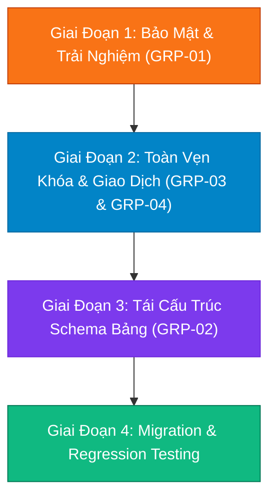

# Kế Hoạch Nghiên Cứu & Khắc Phục Lỗi Hệ Thống (Issue Resolution Checklist)

> **Tài liệu nguồn:** [.agents/docs/data_risk.md](file:///e:/lap_trinh/Project/website/KhangVietDesign/source/.agents/docs/data_risk.md)  
> **Mục tiêu:** Phân nhóm có hệ thống các vấn đề kỹ thuật, phân cấp độ ưu tiên, rà soát tác động và thiết lập checklist hành động cụ thể để nghiên cứu, khắc phục và kiểm thử tuần tự.

---

## 1. Bảng Tổng Quan & Phân Nhóm Vấn Đề

Các vấn đề từ sổ tay đánh giá rủi ro được chia thành 4 nhóm nghiệp vụ & kỹ thuật chính:

| Mã Nhóm | Lĩnh Vực / Module | Trọng Tâm | Mức Độ Ưu Tiên | Các Hạng Mục Liên Quan |
| :--- | :--- | :--- | :--- | :--- |
| **GRP-01** | **Bảo Mật & Quản Lý Phiên (Auth & Session UX)** | Trải nghiệm Admin, Silent Refresh, xử lý hết hạn Token | `CRITICAL / HIGH` | ITEM-06 |
| **GRP-02** | **Cấu Trúc Bảng & Kiến Trúc Dữ Liệu (Schema & RDBMS)** | Khắc phục JSON blob, chuẩn hóa dữ liệu, sẵn sàng scale | `HIGH` | ITEM-05 |
| **GRP-03** | **Định Danh & Ràng Buộc Khóa Chính (UUIDv7 & Integrity)** | Tự động hóa UUIDv7, thư viện chuẩn, chống phân mảnh SQLite | `MEDIUM` | ITEM-01, ITEM-02 |
| **GRP-04** | **Tính Toàn Vẹn Giao Dịch & Tài Nguyên (Transaction & Storage)** | ACID transaction cho Lead, quy tắc cô lập R2 Assets | `MEDIUM` | ITEM-03, ITEM-04 |

---

## 2. Checklist Chi Tiết Theo Từng Nhóm

---

### GRP-01: Bảo Mật & Quản Lý Phiên Làm Việc (Auth & Session UX)
> **Mục tiêu:** Ngăn chặn tình trạng mất dữ liệu form khi Token hết hạn; tự động làm mới Access Token trong nền và điều hướng an toàn khi phiên kết thúc.

- [ ] **1. Nghiên cứu & Thiết kế Fetch Interceptor (Silent Refresh)**
  - [ ] Rà soát cách gửi request hiện tại trong `apps/web/components/modules/admin/shared/adminClient.ts`.
  - [ ] Thiết kế cơ chế bắt mã `401 Unauthorized`: tạm hoãn request đang chờ, gửi request `POST /api/auth/refresh` bằng cookie `refreshToken`.
  - [ ] Xử lý hàng đợi request (request queue) khi có nhiều request đồng thời gặp mã 401 cùng một lúc để tránh gọi refresh nhiều lần lặp lại.
- [ ] **2. Cơ chế Transparent Retry & Lưu Trữ Token**
  - [ ] Khi refresh thành công: Cập nhật `kv_access_token` mới vào `localStorage`, gắn lại header `Authorization: Bearer <newToken>` và retry request gốc.
- [ ] **3. Xử lý hết hạn phiên dứt khoát (Session Expiry / Logout)**
  - [ ] Khi refresh thất bại hoặc cookie refresh token hết hạn: Dọn dẹp sạch `localStorage`, chuyển hướng về `/login?redirect=/admin`.
  - [ ] Hiển thị thông báo hoặc toast báo hiệu phiên đăng nhập đã kết thúc để người dùng không bị bối rối.
- [ ] **4. (Tùy chọn) Proactive Token Refresh Timer**
  - [ ] Giải mã trường `exp` trong Access Token JWT ở client để kích hoạt refresh trước thời điểm hết hạn 1–2 phút.

---

### GRP-02: Chuẩn Hóa Cấu Trúc Bảng & Kiến Trúc Dữ Liệu (Schema & RDBMS)
> **Mục tiêu:** Xóa bỏ Anti-Pattern lưu JSON nguyên khối (JSON blob) trong `cms_metadata`, chuyển đổi thành các bảng quan hệ có schema và index chuẩn.

- [ ] **1. Tách Bảng Độc Lập Cho `hero_slides`**
  - [ ] Thiết kế schema Drizzle mới (`hero-slides.schema.ts`):
    - Các cột: `id` (UUIDv7), `title`, `subtitle`, `image_url`, `cta_label`, `cta_link`, `display_order` (integer), `is_active` (boolean), `created_at`, `updated_at`.
    - Index trên: `is_active`, `display_order`.
  - [ ] Viết repository riêng cho `hero_slides` với các phương thức CRUD chuẩn SQL.
  - [ ] Cập nhật endpoint `GET /api/v1/content/landing` và `PUT /api/v1/admin/cms/hero` sang truy vấn trực tiếp bảng mới.
- [ ] **2. Tái Cấu Trúc `legal_info` Sang Bảng Hồ Sơ Doanh Nghiệp (`businesses` / `company_profiles`)**
  - [ ] Chuẩn hóa các trường thông tin: Mã số thuế (`tax_id`), Người đại diện (`legal_representative`), Hotline (`hotline`), Email (`email`), Địa chỉ trụ sở, Địa chỉ nhà xưởng.
  - [ ] Tạo bảng mới trong Drizzle ORM có kiểu dữ liệu rõ ràng thay vì parse JSON không xác định.
- [ ] **3. Kế Hoạch Migration Dữ Liệu & Tương Thích Ngược**
  - [ ] Tạo file script/migration trích xuất dữ liệu cũ từ `cms_metadata` sang bảng mới.
  - [ ] Cập nhật và tinh gọn lại `apps/api/src/routes/adminCms.ts`.

---

### GRP-03: Định Danh & Ràng Buộc Khóa Chính (UUIDv7 & Key Standards)
> **Mục tiêu:** Đảm bảo toàn bộ khóa chính trong cơ sở dữ liệu luôn tuân thủ chuẩn UUIDv7 tuần tự thời gian, tự động hóa ở cấp ORM và chống phân mảnh B-Tree.

- [ ] **1. Tự Động Hóa Sinh Khóa Chính Ở Tầng Drizzle Schema**
  - [ ] Rà soát toàn bộ các bảng trong `packages/repositories/src/d1/schema/*.ts`.
  - [ ] Thêm `$defaultFn(() => generateUuidV7())` trực tiếp vào định nghĩa `id` của từng bảng (không để controller/repo phải gọi thủ công).
- [ ] **2. Đánh Giá & Tích Hợp Thư Viện Chuẩn `uuidv7`**
  - [ ] Đánh giá thay thế hàm tự viết `generateUuidV7()` tại `packages/repositories/src/d1/uuid-v7.ts` bằng package chính thức `uuidv7`.
  - [ ] Đảm bảo cơ chế Monotonic Counter để duy trì thứ tự sắp xếp tuyệt đối khi có concurrency lớn trong cùng 1 mili-giây.
- [ ] **3. Bổ Sung Ràng Buộc Validation Tại Tầng Zod Contract**
  - [ ] Khai báo `uuidV7Schema` trong `packages/types` với regex kiểm tra version `7` (`-7xxx-`) và variant `-[89ab]xxx-`.
  - [ ] Thay thế các `z.string().uuid()` chung chung bằng `uuidV7Schema` để loại bỏ nguy cơ vô tình lọt UUIDv4 vào DB.

---

### GRP-04: Tính Toàn Vẹn Giao Dịch & Quy Chuẩn Tài Nguyên Media (ACID & Storage)
> **Mục tiêu:** Bảo vệ tính nhất quán dữ liệu khách hàng (Leads) khi gặp race condition và bảo vệ liên kết file ảnh trên Cloudflare R2.

- [ ] **1. Đảm Bảo Tính Nguyên Tử (Atomic Transaction) Khi Tiếp Nhận Lead**
  - [ ] Sửa phương thức tạo Lead tại `packages/repositories/src/d1/repositories/d1-lead-repository.ts`:
    - Gộp thao tác `findOrCreateIdentity` và `createLead` vào cơ chế batching nguyên tử của Cloudflare D1 (`client.batch([...])`).
  - [ ] Thêm ràng buộc `unique()` cho cột `phone` trong bảng `identities` để tránh duplicate bản ghi khi submit trùng lặp cùng tích tắc.
- [ ] **2. Thực Thi Quy Chuẩn Cô Lập Tài Nguyên R2 (Isolated Asset Copies)**
  - [ ] Đảm bảo service upload media tuân thủ quy tắc đường dẫn: `projects/${projectId}/${uuid}.webp`.
  - [ ] Nghiêm cấm 2 bản ghi `project_media` khác `projectId` trỏ chung 1 `r2_key` để đảm bảo lệnh `ON DELETE CASCADE` của một dự án không xóa nhầm file của dự án khác.

---

## 3. Lộ Trình Triển Khai Khuyến Nghị (Step-by-Step Execution Plan)

1. **Giai đoạn 1 (Ưu tiên cao nhất):** Xử lý ngay **GRP-01 (Fetch Interceptor & Token Refresh)** vì ảnh hưởng trực tiếp tới công việc hàng ngày của ban quản trị, tránh mất mát dữ liệu đang nhập liệu.
2. **Giai đoạn 2 (Tính toàn vẹn dữ liệu lõi):** Triển khai **GRP-03** (Tự động hóa UUIDv7) và **GRP-04** (D1 Batch Transaction cho Lead). Các hạng mục này sửa đổi nội bộ trong repository layer mà không làm thay đổi cấu trúc bảng lớn.
3. **Giai đoạn 3 (Refactor cấu trúc bảng):** Triển khai **GRP-02** (Tách `hero_slides` và chuẩn hóa bảng thông tin pháp lý doanh nghiệp).
4. **Giai đoạn 4 (Kiểm thử & Bàn giao):** Chạy kiểm thử tự động, sinh migration D1 và kiểm tra hồi quy trên môi trường staging trước khi deploy production.
