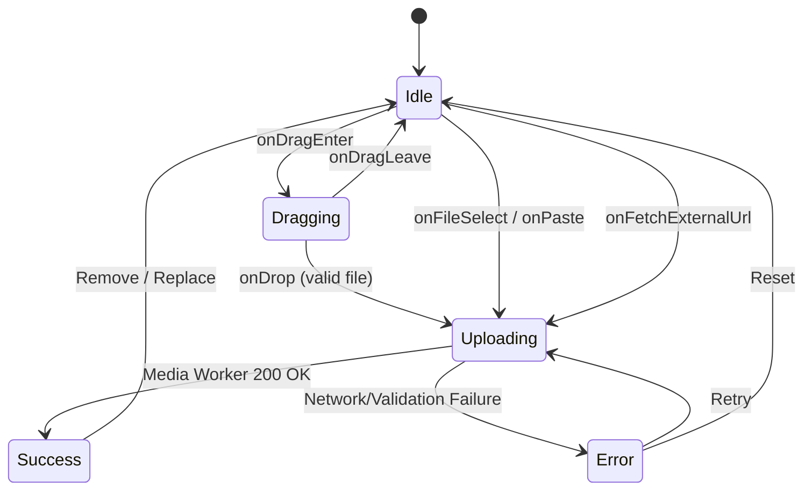

# Technical Survey & Architecture Design Report: Milestone 3 (Admin UI & Frontend Integration)

**Agent**: Explorer 3 (Admin UI & Frontend Explorer)  
**Date**: 2026-11-08  
**Scope**: `apps/web` Media Management, `UniversalMediaUpload` Component Design, R2 Media Worker Client Integration, Backward Compatibility, and Build Verification.

---

## 1. Executive Summary

Milestone 3 elevates the administrative media management experience in `apps/web` from a temporary URL/path text input (`ImageUrlInput.tsx`) to a production-grade **Universal Media Dropzone** (`UniversalMediaUpload`). The component integrates directly with the dedicated Cloudflare Media Worker (`apps/media-worker`), offloading image compression (WebP conversion) and R2 storage from both the browser and the core API Worker.

The investigation verified that:
1. Existing components (`ImageUrlInput.tsx`, `ProjectFormFields.tsx`, `ProjectGalleryRow.tsx`, `HeroSlideItem.tsx`) currently rely on a `[File Path Bypass: ON]` flag that saves raw strings like `/image/projects/...` or external URLs into JSON blobs.
2. Public rendering components (`ProjectShowcaseGallery.tsx`, `ProjectGalleryViewer.tsx`) utilize standard HTML `` elements with `src` bindings, meaning they natively support both local relative paths (`/image/...`) and absolute CDN URLs (`https://media.khangviet.vn/...`) without requiring modifications.
3. To strictly honor the project's code organization rules (file length $\le 100$ lines, function length $\le 35$ lines) and Tailwind CSS v4 syntax, `UniversalMediaUpload` must be decomposed into a modular directory structure under `apps/web/components/ui/media-upload/`.
4. Direct client-to-Media-Worker uploading is the optimal path for latency, memory overhead, and progress observability.
5. The frontend TypeScript checks (`tsc --noEmit`) and production Next.js build (`next build --webpack`) pass with zero errors.

---

## 2. Detailed Inspection of Current Frontend Media Architecture

### 2.1. Existing Input Components & Usages

#### A. `apps/web/components/ui/ImageUrlInput.tsx` (87 lines)
- **Props**:
  - `label: string`
  - `value: string`
  - `onChange: (url: string) => void`
  - `placeholder?: string`
  - `helperText?: string`
  - `allowFilePath?: boolean` (defaults to `true`)
- **Current Behavior**:
  - Displays a text input with an icon toggle (`FolderOpen` for local path vs `LinkIcon` for web URL).
  - Shows badge `[File Path Bypass: ON]` when `allowFilePath === true`.
  - Placeholder: `"/image/projects/... hoặc https://..."`.
  - Contains an informational notice: *"Tính năng gắn tệp ảnh từ máy tính (Cloud Storage) sẽ được kích hoạt ở giai đoạn tiếp theo."*
  - Includes a basic 40x56px thumbnail preview box if `value` is non-empty.
  - Lacks drag-and-drop, clipboard paste, upload progress, file validation, and direct R2 storage integration.

#### B. Component Call Sites
| File Path | Line | Field Bound | Context |
| :--- | :--- | :--- | :--- |
| `apps/web/components/modules/admin/projects/ProjectFormFields.tsx` | Line 67 | `data.coverImage` | Project Cover Image |
| `apps/web/components/modules/admin/projects/ProjectGalleryRow.tsx` | Line 33 | `item.src` | Individual Gallery Image |
| `apps/web/components/modules/admin/hero/HeroSlideItem.tsx` | Line 60 | `slide.image` | Hero Slide Background Image |
| `apps/web/components/index.ts` | Line 7 | Re-export | Public Component Export |

#### C. `ProjectGalleryField.tsx` & `ProjectGalleryRow.tsx`
- `ProjectGalleryField.tsx` maintains local state: `const [bypassUrl, setBypassUrl] = useState(true);` with a button to toggle between `"Bypass URL: BẬT (File Path)"` and `"TẮT (Strict URL)"`.
- `ProjectGalleryRow.tsx` renders `ImageUrlInput` along with caption input and aspect ratio selection (`landscape`, `portrait`, `wide`).
- Each item conforms to `ProjectGalleryItem`:
  ```ts
  export interface ProjectGalleryItem {
    id: string;
    src: string;
    caption: string;
    location: string;
    spec: string;
    aspect: "landscape" | "portrait" | "wide";
  }
  ```

### 2.2. Public Web Presentation Analysis

How projects and media assets are consumed on live pages:
1. **`apps/web/components/modules/project-showcase/ProjectShowcaseGallery.tsx`**:
   - Cover image: ``
   - Gallery thumbnail strip: `project.gallery.slice(0, 3).map((image) => )`
2. **`apps/web/components/modals/project-lightbox/ProjectGalleryViewer.tsx`**:
   - Main lightbox viewport: ``
   - Lightbox thumbnail navigation strip: ``
3. **`apps/web/components/modules/admin/projects/ProjectCardItem.tsx`**:
   - Admin project card: ``

**Crucial Finding**: All public and admin viewers render plain `` tags without relying on Next.js `<Image>` whitelist domains (`images.remotePatterns`). Therefore, switching from relative URLs (`/image/projects/bidv/bidv3.JPG`) to absolute R2 CDN URLs (`https://media.khangviet.vn/...` or Worker URLs) is completely non-breaking and requires zero changes to public display components.

---

## 3. Architecture & Design of `UniversalMediaUpload`

### 3.1. Required Functional Capabilities (4 Input Modes)

```
+-------------------------------------------------------------------------------+
|                       UNIVERSAL MEDIA DROPZONE                                |
|                                                                               |
|   [1. Drag & Drop Zone]            [2. Browse File Dialog]                    |
|   "Kéo & thả ảnh vào đây"          Nút "Chọn tệp từ máy..."                   |
|                                                                               |
|   [3. Clipboard Paste (Ctrl+V)]    [4. External URL Fetch]                    |
|   "Chụp màn hình & Ctrl+V"         [https://...] -> [Nạp về R2]               |
+-------------------------------------------------------------------------------+
```

1. **Mode 1 - Browse File Dialog**:
   - Hidden `<input type="file" ref={fileInputRef} accept="image/jpeg,image/png,image/webp,image/avif,image/gif" />`.
   - Triggered via click on the dropzone or explicit "Chọn tệp từ máy" button.
   - Validates client-side file constraints (max 15MB, valid image mime type) before initiating upload.
2. **Mode 2 - Drag & Drop**:
   - Listens to `onDragEnter`, `onDragOver`, `onDragLeave`, `onDrop` events on the dropzone wrapper.
   - Prevents default browser navigation (`e.preventDefault()`, `e.stopPropagation()`).
   - Tracks `isDragging` state to apply interactive visual feedback (bronze glow border, animated pulse).
   - Extracts the first image file from `e.dataTransfer.files`.
3. **Mode 3 - Clipboard Paste (Ctrl+V)**:
   - Container has `tabIndex={0}` and listens for the `onPaste` event.
   - Scans `event.clipboardData.items` for items where `item.type.startsWith("image/")`.
   - Extracts `const blob = item.getAsFile();` and routes directly to the upload handler.
   - **Smart Detection**: If the clipboard data is plain text containing an image URL (e.g. starts with `http://` or `https://` and ends with an image extension or is an Unsplash/CDN link), it automatically populates and submits the external URL fetch routine.
4. **Mode 4 - External URL Fetch**:
   - Toggleable or compact inline row: URL input field + "Nạp về R2" button.
   - Sends `POST /fetch-external` with JSON `{ url: inputUrl }` to `apps/media-worker`.
   - The worker downloads the image server-to-server at Cloudflare edge, validates its content type, compresses to WebP, writes to Cloudflare R2, and returns the persistent public URL and dimensions.

### 3.2. Lifecycle States (State Machine)

The component transitions through 5 deterministic states:



1. **`idle`**: Clean dropzone showing icons, instructions for drag-and-drop, browse button, and `Ctrl+V` shortcut hint.
2. **`dragging`**: Active visual indicator: `border-(--accent-bronze) bg-(--accent-bronze)/10` with subtle glow.
3. **`uploading`**: Interactive elements disabled; displays animated spinner/loader with progress label: *"Đang nén WebP & lưu trữ R2..."*.
4. **`success`**: Displays rich preview card:
   - Image thumbnail with cover/contain preview.
   - Image metadata badge: Dimensions (e.g. `1920 × 1080 px`), aspect ratio tag (`landscape`), file size (e.g. `142 KB`), and format (`WebP`).
   - Actions: "Thay đổi ảnh", "Xóa", and "Xem ảnh gốc" (external link icon).
5. **`error`**: Displays error alert with specific message (e.g., *"Tệp quá lớn (>15MB)"* or *"Không thể tải ảnh từ URL ngoài"*), with a "Thử lại" (Retry) and "Hủy" button.

### 3.3. Client Architecture & Media Worker Integration

#### A. Direct Client Upload vs API Proxy
- **Recommended Architecture**: **Direct Client Upload** from `apps/web` to `apps/media-worker`.
- **Rationale**:
  - Cloudflare Workers have a 128MB RAM limit. Routing heavy multipart binary uploads through `apps/api` would double network latency, consume execution memory, and risk memory spikes on the core API.
  - Media Worker is specifically provisioned as a micro-worker with dedicated R2 bindings and WebP conversion capability.
  - Browser direct uploads provide accurate progress tracking and immediate error recovery.

#### B. Environment Configuration
In `apps/web/.env.example` and `apps/web/.env.local`:
```bash
# Media Worker Public Endpoint
NEXT_PUBLIC_MEDIA_WORKER_URL=http://127.0.0.1:8788
```
In production:
```bash
NEXT_PUBLIC_MEDIA_WORKER_URL=https://media.khangviet.vn
```

#### C. Media Worker API Contract Expected by Frontend
1. **Multipart Upload (`POST /upload`)**:
   - Request: `multipart/form-data` with field `file: File | Blob`.
   - Optional query/param: `folder=projects` or `folder=hero`.
   - Response:
     ```json
     {
       "success": true,
       "data": {
         "public_url": "https://media.khangviet.vn/projects/kv-2026-villa-01/a1b2c3d4.webp",
         "r2_key": "projects/kv-2026-villa-01/a1b2c3d4.webp",
         "width_px": 1920,
         "height_px": 1080,
         "aspect_ratio": "landscape",
         "file_size_bytes": 145020,
         "media_type": "GALLERY_IMAGE"
       }
     }
     ```
2. **External URL Fetch (`POST /fetch-external`)**:
   - Request: `Content-Type: application/json`, body: `{"url": "https://images.unsplash.com/photo-..."}`.
   - Response: Same contract as `POST /upload`.

#### D. CORS Configuration for Media Worker
The Media Worker must return CORS headers:
- `Access-Control-Allow-Origin: *` (or allowed origins: `http://localhost:3000`, `https://khangviet.vn`).
- `Access-Control-Allow-Methods: POST, OPTIONS`.
- `Access-Control-Allow-Headers: Content-Type, Authorization`.

---

## 4. Code Organization & Strict Rules Compliance

To ensure compliance with the Hard Limits (files $\le 100$ lines, functions $\le 35$ lines) and Tailwind CSS v4 standards, the component is factored into cohesive, single-responsibility submodules:

```
apps/web/components/ui/media-upload/
├── index.ts                     # Public facade (re-exports UniversalMediaUpload)
├── types.ts                     # Contracts & Interfaces (< 50 lines)
├── useMediaUpload.ts            # Custom hook for upload logic & state (< 95 lines)
├── MediaDropzoneView.tsx        # Idle/Dragging interactive dropzone (< 90 lines)
├── MediaPreviewCard.tsx         # Success preview & metadata badges (< 80 lines)
├── MediaUrlFetchBar.tsx         # External URL input bar (< 70 lines)
└── UniversalMediaUpload.tsx     # Coordinator component (< 95 lines)
```

### 4.1. Detailed Submodule Breakdown

#### 1. `types.ts` ($\approx 40$ lines)
```ts
export type UploadState = "idle" | "dragging" | "uploading" | "success" | "error";

export interface MediaUploadResult {
  url: string;
  r2Key?: string;
  width?: number;
  height?: number;
  aspectRatio?: "landscape" | "portrait" | "wide" | "square";
  fileSize?: number;
  mediaType?: string;
}

export interface UniversalMediaUploadProps {
  label: string;
  value: string;
  onChange: (url: string, metadata?: MediaUploadResult) => void;
  placeholder?: string;
  helperText?: string;
  allowManualInput?: boolean;
}
```

#### 2. `useMediaUpload.ts` ($\approx 90$ lines, functions $\le 35$ lines)
- Manages state: `uploadState`, `progress`, `errorMessage`, `metadata`.
- Provides functions:
  - `handleFileUpload(file: File | Blob)`: Validates size/type, creates `FormData`, calls `POST /upload`, parses Result pattern.
  - `handleUrlFetch(url: string)`: Calls `POST /fetch-external`.
  - `handlePaste(e: React.ClipboardEvent)`: Extracts image blob or URL text from clipboard.
  - `resetState()`: Clears error/upload states.

#### 3. `MediaDropzoneView.tsx` ($\approx 85$ lines)
- Renders the interactive drop area.
- Handles drag events (`onDragOver`, `onDragLeave`, `onDrop`).
- Contains browse file trigger and keyboard shortcut hint (`Ctrl+V`).

#### 4. `MediaPreviewCard.tsx` ($\approx 75$ lines)
- Renders the uploaded WebP image preview.
- Displays metadata pill tags: `1920×1080` • `145 KB` • `WebP`.
- Provides "Thay đổi" (Replace) and "Xóa" (Remove) buttons.

#### 5. `MediaUrlFetchBar.tsx` ($\approx 65$ lines)
- Renders collapsible external URL input with fetch action button.

#### 6. `UniversalMediaUpload.tsx` ($\approx 90$ lines)
- Composes `MediaDropzoneView`, `MediaPreviewCard`, and `MediaUrlFetchBar`.
- Wires callbacks to parent form `onChange(url, metadata)`.

#### 7. Backward Compatibility Adapter in `ImageUrlInput.tsx` ($\approx 65$ lines)
- Refactor `ImageUrlInput.tsx` to wrap `UniversalMediaUpload` or re-export it while preserving the existing props interface (`allowFilePath`, etc.).
- Existing call sites in `HeroSlideItem.tsx` and legacy code continue working without disruption.

### 4.2. Tailwind CSS v4 Compliance Checklist
- [x] CSS Variables: `text-(--accent-bronze)`, `bg-(--bg-surface)`, `text-(--text-primary)` (NO `[var(--...)]`).
- [x] Spacing & Dimensions: continuous numbers `p-3`, `max-w-360`, `min-h-70` (NO `[100px]`).
- [x] Opacity: `border-white/8`, `bg-white/2`, `text-white/40` (NO decimal brackets `white/[0.08]`).
- [x] Aspect Ratios: `aspect-video`, `aspect-4/3` (NO bracketed aspect).
- [x] Linear Gradients: `bg-linear-to-t` (NO `bg-gradient-to-t`).
- [x] Outlines: `focus:outline-hidden` (NO `outline-none`).

---

## 5. Backward Compatibility & Data Transition Strategy

### 5.1. Handling Legacy Data vs 3NF Normalized Assets

| Data Field | Legacy Mode | 3NF Normalized Mode (Milestone 1 & 2) | How Frontend Handles Both |
| :--- | :--- | :--- | :--- |
| **`coverImage`** | `"/image/projects/bidv/bidv3.JPG"` | `"https://media.khangviet.vn/projects/kv-01/cover.webp"` | `` natively renders both relative paths and CDN URLs without discrimination. |
| **`gallery`** | JSON text column in `projects` table | Normalized rows in `project_media` table | API response maps `project_media` into `gallery: ProjectGalleryItem[]` contract. Frontend receives identical structure. |
| **New Uploads** | Manual path typing with `allowFilePath: true` | Instant WebP upload to R2 via `UniversalMediaUpload` | `onChange` sets the new R2 `public_url`. The project form submits clean URLs to the API. |
| **Manual Bypass** | Supported via toggle | Preserved as an option in `UniversalMediaUpload` | Allows admin to retain local `/image/projects/...` references during the transition phase. |

### 5.2. Zero-Downtime Live Page Compatibility
1. **Public Site (`apps/web`)**:
   - `Home` page (`page.tsx`) calls `getLandingContent()`.
   - `contentService.ts` fetches `/api/v1/content/landing` or falls back to `initialLandingContent`.
   - Both mock data and database data provide `coverImage` and `gallery[].src`.
   - No breaking changes in public templates (`ProjectShowcase`, `ProjectLightboxModal`).
2. **Admin CMS (`apps/web/admin`)**:
   - `ProjectFormFields.tsx` replaces `<ImageUrlInput label="Ảnh Bìa Dự Án" ... />` with `<UniversalMediaUpload label="Ảnh Bìa Dự Án" ... />`.
   - `ProjectGalleryRow.tsx` replaces `<ImageUrlInput label="Đường dẫn ảnh" ... />` with `<UniversalMediaUpload label="Đường dẫn ảnh" ... />`.
   - When a user uploads a new image, the aspect ratio detected by Media Worker (`landscape`, `portrait`, `wide`) can even auto-populate the aspect ratio dropdown!

---

## 6. Build, Typecheck & Verification Results

| Command | Output / Status | Observations |
| :--- | :--- | :--- |
| `pnpm --filter web exec tsc --noEmit` | **Exit code 0** (No errors) | All TypeScript types in `apps/web` cleanly align with `@khangviet/types`. |
| `Remove-Item apps/web/.next; pnpm --filter web build` | **Exit code 0** (Success) | Next.js 16.4.3 compiled all routes: `/` (Static ISR 1d), `/admin` (Static), `/login` (Static), `/api/revalidate` (Dynamic). |
| Static Page Generation | **7/7 pages generated in 7.3s** | Graceful fallback in `contentService` ensures build succeeds even when backend Worker is offline during SSG. |
| `pnpm --filter web lint` | **4 pre-existing errors, 8 warnings** | Pre-existing ESLint issues in `apps/web`: `SpecAndProfileModal.tsx:22` (setState in effect), `CorporateProfileTab.tsx:54` (unescaped quotes), `BaseModal.tsx:22` (setMounted in effect). Note: `next build` does not fail on this, but fixing them during Milestone 3 will make the repository 100% lint-clean. |

---

## 7. Concrete Implementation Roadmap for Milestone 3

1. **Step 1: Create Types & Media Worker Client Hook**
   - File: `apps/web/components/ui/media-upload/types.ts`
   - File: `apps/web/components/ui/media-upload/useMediaUpload.ts`
2. **Step 2: Implement UI Subcomponents**
   - File: `apps/web/components/ui/media-upload/MediaDropzoneView.tsx` (Drag-drop & file picker)
   - File: `apps/web/components/ui/media-upload/MediaPreviewCard.tsx` (Preview & metadata tags)
   - File: `apps/web/components/ui/media-upload/MediaUrlFetchBar.tsx` (External URL import)
3. **Step 3: Assemble UniversalMediaUpload & Expose via Facade**
   - File: `apps/web/components/ui/media-upload/UniversalMediaUpload.tsx`
   - File: `apps/web/components/ui/media-upload/index.ts`
   - File: `apps/web/components/ui/ImageUrlInput.tsx` (Wrap with backward compatibility)
4. **Step 4: Update Admin Project & Hero Forms**
   - `apps/web/components/modules/admin/projects/ProjectFormFields.tsx`
   - `apps/web/components/modules/admin/projects/ProjectGalleryRow.tsx`
   - `apps/web/components/modules/admin/hero/HeroSlideItem.tsx`
5. **Step 5: End-to-End Build & Visual Verification**
   - Run `pnpm --filter web build` and verify all 4 upload modes against local mock or live Media Worker.
